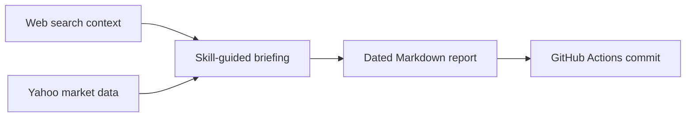

# Market News

**English** · [简体中文](README.zh-CN.md)

What happened while I was asleep? A small automation for a very recurring question.

A Chinese-language market briefing pipeline. It combines web-search context, market data, and a reusable Skill prompt, then saves Markdown reports through GitHub Actions. The workflow is configured for `00:00 UTC`, or 08:00 in Hong Kong/Beijing; scheduled runs can be delayed by GitHub.

[Reports](reports/) · [Briefing specification](skill/SKILL.md) · [Generator](scripts/generate_report.py)

## What a briefing contains

Eight sections cover US indices, major news, cross-asset prices, sector rotation, sentiment, available A-share data, the week's calendar, and points to watch. The target length is 40–80 lines.

The experiment is also about portability: can a conversational Skill become a scheduled workflow? Here, `skill/SKILL.md` serves as the pipeline's system prompt as well as an interactive Skill.



The generator runs ten search groups and requests 12 market values through `yfinance`. The supplied price table is the source for those values; search supplies news and interpretation.

## Run locally

```bash
git clone https://github.com/Bill306/Market-News.git
cd Market-News
pip install -r requirements.txt
```

Configure `ANTHROPIC_AUTH_TOKEN`, `ANTHROPIC_BASE_URL`, and `ANTHROPIC_MODEL` in your environment, using credentials for the compatible provider you select. The repository workflow uses the DeepSeek Anthropic-compatible endpoint. Then run:

```bash
python scripts/generate_report.py
```

Output: `reports/YYYY-MM-DD.md`.

For a fork's Actions workflow, add `DEEPSEEK_API_KEY` under Settings > Secrets > Actions, inspect [.github/workflows/daily-market-news.yml](.github/workflows/daily-market-news.yml), then manually run **Daily Market News Briefing**. The Skill can also be installed from `skill/` into `~/.claude/skills/daily-market-news/`.

## Read with the sources nearby

Yahoo Finance is an unofficial data source. Missing values remain unavailable. Futures and crypto quotes may be latest observations rather than exchange closes, so their dates matter. Sector returns and the fear-and-greed measure still depend on search snippets; search results may include older news. Generated interpretation needs verification against original sources before reuse.

The [reports directory](reports/) records completed outputs. A configured schedule does not establish that every daily run succeeded.
